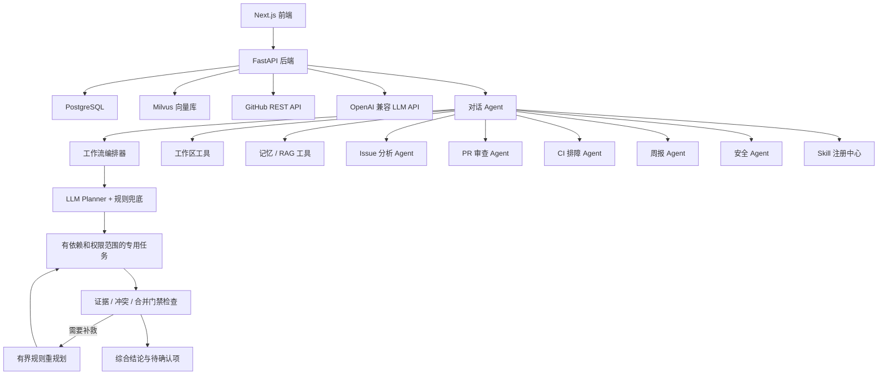

# RepoPilot AI

RepoPilot AI 是一个持续迭代的个人项目，面向 GitHub PR / Issue 研发协作。它连接仓库数据，结合 CI 日志、项目知识库和本地代码，帮助分析「这个 PR 能否合并」「CI 为什么失败」「类似问题过去如何处理」，并提供结构化建议、证据引用和需要人工确认的操作草稿。

## 核心能力

- 连接并同步 GitHub 仓库中的 Issue、Pull Request、PR 文件、Review 评论、Workflow Run、Job 和日志。
- Issue 分析：分类、优先级、复杂度、推荐负责人、重复候选和行动项。
- PR 审查：摘要、关键变更、P1/P2/P3 分级风险、阻塞项、测试建议和需要重点关注的文件。
- CI 排障：结合 Job、Step 和失败日志定位首个错误，区分已有证据与根因推断，给出排查和验证步骤。
- Agent 对话：`ChatAgent` 使用原生工具调用，串联工作区、记忆、RAG、Issue、PR、CI、周报和安全工具。
- 多 Agent 工作流审查：`WorkflowOrchestrator` 构建 Planner -> 专用 Agent -> Observer -> Synthesis 的闭环，用于 PR 就绪度、阻塞项、优先级和跨领域工程决策。
- Skill Runtime：按用户显式指定或触发条件选择 `SKILL.md`，只向当前任务加载完整指令与受限资源；显式 Skill 校验允许工具，多 Agent 中的专用 Agent 分别加载自己的 Skill，并把版本、激活原因、指令摘要和执行校验写入 trace。
- 工作区代码工具：安全地列出文件、读取文件和搜索本地代码。
- RAG 聚焦 Issue 描述、PR 说明与 Review 评论、失败 CI 日志、项目文档、上传知识和已批准的长期记忆；当前代码走工作区/词法检索，团队与实时状态走结构化查询。
- 项目资料接入：后台准备源码、就绪检查、文档扫描与可配置索引范围；失败可重试。
- 安全操作：GitHub 写入先生成草稿，人工确认并通过权限检查后才执行，保留执行结果与审计记录。
- 生成工程周报。
- 基础 Eval 覆盖 Issue 分类、PR 覆盖度、RAG 命中率、工具 schema 就绪度和结构化输出校验。

## 技术栈

- 后端：Python、FastAPI、Pydantic、SQLAlchemy、PostgreSQL、Milvus、httpx、LangChain。
- Agent 编排：原生工具调用 + 专用分析 Agent。
- 前端：Next.js、TypeScript、Tailwind CSS、React Query。
- 基础设施：Docker Compose 与 `.env` 配置。

## 架构



## 工程工作流与验证

计划模式先生成可预览的 `WorkflowSpec`，确认后再执行；ChatAgent 也可以在调查过程中调用同一套工程协作工作流。Planner 与 ChatAgent 复用模型配置，LLM 负责理解目标、选择任务和依赖，服务端通过任务白名单、固定目标、来源权限与 DAG 校验限制执行范围，并合并原有规则约束。模型超时或输出无效时，整体回退到规则计划。

执行器按依赖调度就绪任务，Observer 检查证据缺口、跨 Agent 冲突和合并阻塞项，需要补救时沿用有次数上限的规则重规划，最后由 Synthesis 汇总结论。执行后的计划、任务结果和观察事件沿用现有工作流记录保存，前端可查看规划来源、工具过程、检索证据与引用。依赖边只控制执行顺序，不会自动把上游结果注入下游。

已有一组使用 `deepseek-v4-pro` 的 Planner 对比：10 个固定合成用例各运行两次，规则与 LLM Planner 使用相同上下文。

| 指标 | 原规则 | LLM + 规则约束 |
| --- | ---: | ---: |
| 任务、指定顺序和范围检查均通过 | 4/20 | 19/20 |
| 任务集合匹配 | 4/20 | 20/20 |
| 选中任务总数 | 72 | 50 |
| 规划耗时中位数 | 0.01 ms | 4247.25 ms |

这组开发用例验证了排除要求和同义表达下的任务选择；仍有一次遗漏了 CI → PR 依赖。测试只运行规划，不衡量最终诊断准确率或完整工作流成本，样本结果也不代表线上整体表现。可查看 [固定用例](docs/evaluations/planner-cases-v1.json)、[原始结果](docs/evaluations/planner-live-2026-10-22.json) 和 [实现及验证说明](docs/architecture/planner-llm-upgrade.md)。

## 快速开始

准备 Python 3.12、Node.js 20+ 与 Docker Compose。以下命令适用于 macOS / Linux，从项目根目录执行：

```bash
cp .env.example .env
docker compose up -d postgres etcd minio milvus

python3 -m venv backend/.venv
source backend/.venv/bin/activate
python -m pip install -r backend/requirements.txt
# 默认 Qwen 本地 Embedding 所需依赖
python -m pip install -r backend/requirements-local-embedding.txt

cd backend
python -m uvicorn app.main:app --env-file ../.env --host 127.0.0.1 --port 8000 --reload
```

启动前在 `.env` 填写 `LLM_API_KEY`；`LLM_BASE_URL`、`LLM_MODEL` 可切换到兼容接口。连接私有 GitHub 仓库或提高同步额度时，需要配置 GitHub Token。默认本地 Embedding 首次使用时会下载模型，请预留下载时间；已有缓存的离线配置见 [本地启动说明](LOCAL_START.md)。

另开终端启动前端：

```bash
cd frontend
npm ci
NEXT_PUBLIC_API_BASE_URL=http://localhost:8000 npm run dev
```

默认地址：

- 前端：<http://localhost:3000>
- 后端及健康检查：<http://localhost:8000/health>
- API 文档：<http://localhost:8000/docs>

Windows 使用 `backend\.venv\Scripts\Activate.ps1` 激活环境，并在 `frontend/.env.local` 设置 `NEXT_PUBLIC_API_BASE_URL=http://localhost:8000` 后运行 `npm run dev`。macOS 一键启动、独立端口与已有环境的说明见 [LOCAL_START.md](LOCAL_START.md)；它使用 `docker-compose.local.yml`，端口与上面的标准 Compose 配置不同。

连接仓库后，先确认源码准备完成，再扫描 README、项目文档与配置清单；需要语义召回时继续建立向量索引。状态与失败重试入口位于总览及仓库页面。示例环境可通过 `scripts/seed_demo_data.py` 初始化 `repopilot-demo/sample-api` 的合成数据，用于本地功能验证，不代表真实 GitHub 仓库或真实故障样本。

## RAG 知识问答系统

项目内置 RAG 知识问答系统，覆盖知识库创建向导、文档解析、段落感知切片、Embedding、向量/关键词混合检索、重排、召回测试、问答工作室、上下文组装、基于证据生成和编号引用。支持 TXT、Markdown、PDF、DOCX、JSON、CSV 与日志文件；重复文件会按 SHA-256 跳过。

对话链路采用混合 RAG：`ContextAssembler` 会在调用 ChatAgent 前按原始问题检索并注入证据；进入推理循环后，模型仍可把 `rag.search_similar_documents` 当作工具，改写查询、连续补查不同资料，并根据多次工具结果交叉验证答案。

聊天预检索、Agent 主动检索和 MCP 记忆搜索共用知识问答的完整检索核心，实际读取仓库配置并记录重排、阈值过滤与降级轨迹。正式问答保持严格的证据检查；Agent 可以在证据不足时继续读代码或查询其他工具。实现与验证见 [检索链路与验证](docs/architecture/unified-agent-retrieval.md)。

项目不会把所有私域数据都向量化。只有需要跨来源语义召回、会反复使用的非结构化知识进入 RAG；源码与配置以当前 checkout 为准，优先通过 `workspace.search_code` 和 `workspace.read_file` 检索；Issue、PR、CI 的状态字段、团队成员和周报等结构化或派生数据直接查数据库/API。RAG 返回的是候选证据，涉及实时状态和当前代码时仍要回到权威数据源核验。

从旧版本升级后，请对每个知识库调用一次 `POST /api/rag/{repo_id}/reindex`。重建会按新边界清理历史向量和旧会话 Document；只部署代码不会主动删除已有索引。

如果只想先验证页面、结构化数据和无模型兜底回答，Windows 本地可以用下面的脚本启动 SQLite 演示环境：

```powershell
.\scripts\start_rag.ps1
```

脚本会关闭 Milvus，使用 deterministic embedding 和启发式重排，并停用演示知识库的 `0.8` 分数阈值，避免只有关键词分支时全部候选都被过滤。因此它可以验证页面、上传解析、关系库存储、Hybrid 的关键词分支和引用展示，但向量检索状态会明确显示 `degraded`，不能用来证明完整 RAG 已经跑通。要验证向量召回、混合检索和重建索引，仍需先按“快速开始”启动 PostgreSQL、etcd、MinIO 和 Milvus。

知识库默认选择 `Qwen/Qwen3-Embedding-0.6B` 与 `qwen3-rerank`。安装 `backend/requirements-local-embedding.txt` 后可运行本地 Qwen Embedding；配置 `DASHSCOPE_API_KEY`、`RERANK_BASE_URL` 后可切换百炼 `text-embedding-v4` 与 `qwen3-rerank`。默认 Embedding 依赖缺失时系统会明确报错，不会在生产配置下静默改用另一套向量空间；只有上面的本地演示脚本会显式选择 deterministic embedding。已经配置 `LLM_API_KEY` 时，可用 `.\scripts\start_rag.ps1 -UseConfiguredLLM` 启用模型生成。

RAG API：

```text
POST /api/rag/knowledge-bases
GET  /api/rag/knowledge-bases
GET  /api/rag/knowledge-bases/{repo_id}
POST /api/rag/knowledge-bases/{repo_id}/documents
POST /api/rag/knowledge-bases/{repo_id}/retrieval-tests
GET  /api/rag/{repo_id}/status
POST /api/rag/{repo_id}/search
POST /api/rag/{repo_id}/ask
POST /api/rag/{repo_id}/reindex
```

## ChatAgent RAGAS 评测

启动主应用后打开 `http://127.0.0.1:3000/evals`，选择仓库、可用评测集和 Top-K，再点击“运行固定 RAGAS 评测”。评测会在隔离会话中真实运行生产 ChatAgent 和工具集，收集预检索与 Agent 二次检索证据，然后使用 Ragas 0.4 Collections API 计算 Context Precision、Context Recall、Faithfulness、Answer Relevancy 和 Agent Goal Accuracy。结果会保存评测集 Hash、阈值、逐题工具轨迹、检索证据、硬规则与失败诊断，便于对同一基线做回归。

默认 Judge 复用 `LLM_API_KEY`、`LLM_BASE_URL` 和 `LLM_MODEL`；也可以通过 `.env` 中的 `RAGAS_JUDGE_API_KEY`、`RAGAS_JUDGE_BASE_URL`、`RAGAS_JUDGE_MODEL` 单独配置。

固定 RAGAS 评测集由使用者维护，后端从 `docs/datas/evals/*.json` 加载，检查其引用的来源是否已进入当前仓库知识库。当前仓库未附带该目录下的固定 RAGAS 题集；可以添加自己的用例，或通过 API 的 `cases` 字段提交。页面的“自动文档冒烟测试”从当前文档临时出题，仅用于验证链路。以下请求演示冒烟入口；使用固定评测时，将 `suite_id` 替换成 `GET /api/evals/suites?repo_id=<repository-uuid>` 返回的可用固定集 ID：

```http
POST /api/evals/rag/run
Content-Type: application/json

{
  "repo_id": "<repository-uuid>",
  "run_judge": true,
  "top_k": 5,
  "suite_id": "auto-document-smoke"
}
```

提交接口会立即返回 `queued` 状态和 `eval_id`，ChatAgent 与 RAGAS 在后台继续运行。通过 `GET /api/evals/{eval_id}` 轮询 `result.progress`；状态变为 `passed`、`failed`、`error` 或 `no_cases` 时结束。网页会自动轮询，刷新或离开页面不会中断已经提交的任务。

整体通过要求硬规则全部满足，并且五项语义指标都达到 `.env` 中对应的 `RAGAS_*_MIN` 门槛。页面把“执行状态”和“质量状态”分开显示：低分是质量失败；Judge 调用失败或指标缺失是评测不完整，不能伪装成质量结论。

评测失败后可以直接在同一页面继续处理：

- 展开 Case 查看实际回答、参考答案、检索来源、工具轨迹和可执行诊断；
- 对 Judge 超时或缺失指标点击“仅重试异常评分”，复用已经保存的回答和证据，不重新运行 ChatAgent；
- 选择两个相同评测集 Hash、Ragas/Judge 配置和 Top-K 的结果做回归对比；
- 生成 `create_issue` 类型的 ActionDraft，把失败 Case、证据和建议带入人工确认流程，不会直接写入 GitHub。

## 开发与验证

在后端目录运行确定性回归，不调用真实 LLM：

```bash
cd backend
LLM_API_KEY='' .venv/bin/python -m pytest -q
```

前端构建与开发服务运行保护检查：

```bash
cd frontend
npm run build
npm run test:runtime
```

Planner 的真实模型对比可从项目根目录复跑；`--live` 会使用当前模型配置并产生正常 API 消耗：

```bash
backend/.venv/bin/python scripts/evaluate_planner.py --live --repeats 2 --output docs/evaluations/planner-recheck.json
```

进一步阅读：[工作流设计](docs/architecture/agent_workflow.md)、[统一检索链路](docs/architecture/unified-agent-retrieval.md)、[Planner 实现与验证](docs/architecture/planner-llm-upgrade.md)、[迭代记录与待办](docs/整改待办.md)。当前仍以个人开发和本地部署为主；更大规模的真实样本评估、完整数据库迁移和生产部署配置需要继续完善。
