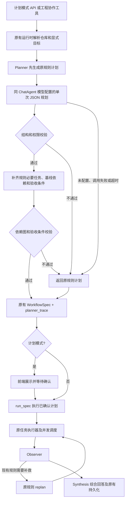

# Planner 同模型接入与规则兜底整改

记录日期：2026-10-22。状态：已实现、已回归、已完成真实模型规划对比。

## 实现结果

Planner 从纯关键词路由变为“LLM 选择任务和依赖 + 原规则约束合并 + 失败整单回退”。
当前与 ChatAgent 一样读取 `settings.llm_model / llm_base_url / llm_api_key`，实测模型为 `deepseek-v4-pro`。
没有单独写死另一套模型版本，也没有修改 ChatAgent 的模型参数。

业务调整集中在 `backend/app/services/agents/planner_agent.py`，原规则主体抽成 `_rule_spec()`，任务内容与选择规则保留。
其余改动仅为提示词、兼容的 trace 字段、事件透传、前端标识及测试/评测记录。

| 部分 | 职责 |
| --- | --- |
| 原规则计划 | 请求开始先生成，模型失败时直接返回；同时提供原有验收条件与任务约束 |
| LLM | 理解肯定/排除、同义表达、任务先后关系，选择已有任务、具体化 objective、补充验收条件 |
| 服务端校验与合并 | 限定任务目录、Agent、目标、来源、写入权限；补齐必要任务和基线依赖，检查 DAG |
| 原调度器 | 按现有依赖图执行，可就绪任务继续并发，默认并行度仍为 3 |
| Observer / 规则 replan / Synthesis | 沿用现有证据检查、补救重规划和最终综合 |

这里的合并不是把所有关键词命中的任务无条件取并集。否则“只排查 CI，不分析 Issue/PR”仍会被关键词误选。
LLM 可以排除可选任务；服务端必须保留以下规则约束：

- 仓库基线 `repo_health`。
- `requires_safety` 对应的 `safety_review` 与人工确认标志。
- 运行时已解析并锁定的显式 Issue、PR、Workflow Run 目标。
- 原有合并/发布关键词触发的 CI 检查，以及显式启用的 RAG 任务。
- 原有六条验收条件、关键任务标志、固定目标和权限范围。

首轮 RAG 任务目录仅在原来的历史/相似/知识关键词或 `enable_rag_task` 条件下开放，避免普通协作审查增加历史检索。
Observer 因证据缺口触发的原有规则补检索仍然保留。

## 提示词和输出契约

`backend/app/services/llm/prompts.py` 新增 `PLANNER_AGENT_PROMPT` 和版本常量 `PLANNER_PROMPT_VERSION`，当前为 `planner-v1.1`。
提示词定义任务选择原则、否定/排除语义、调度依赖、安全边界，以及 JSON 示例。

LLM 继续返回 `WorkflowSpec` 原有业务字段：

```text
goal, trigger_message, acceptance_criteria, tasks,
max_parallel_tasks, requires_human_confirmation

tasks[]:
  id, agent_name, task_type, objective, dependencies,
  claim, input_hint, critical

claim:
  target_type, target_id, allowed_sources, write_intent, reason
```

服务端生成并保留 `workflow_id / created_at`。模型不能改写实际用户目标、并行度、目标编号或人工确认开关。
`claim` 和 `input_hint` 最终取服务端目录中的规范值，模型不能通过它们切换仓库或替换 PR/CI 编号。
模型缩小来源列表也不会丢失原有服务端来源契约；扩大来源则整单拒绝并回退。

校验包含：Pydantic 结构解析、最多每类一个任务、非空任务、固定 ID/Agent/类型匹配、目标一致性、来源白名单、
写权限边界、目标动作和验收文本长度、依赖引用存在性、自依赖/循环检测。
仓库基线依赖缺失时自动补齐，必要规则任务遗漏时从目录补回。
已通过结构检查不等于语义完全正确，漏掉用户要求的依赖顺序仍可能发生，见实测限制。

发送给模型的是用户目标、可用任务目录、目标标识和规则约束，不传任意客户端上下文、凭据、diff、日志、团队画像或记忆正文。
用户自己写在目标中的文本仍会随模型请求发送，和正常模型调用一致。

## 调用预算和失败处理

- Planner 的专用 JSON 适配器继承现有 `LLMClient` 的模型配置；不修改共享客户端的默认行为。
- 单次请求，`temperature=0`，JSON Object 模式，`max_tokens=4096`，总等待预算 20 秒，不在规划阶段反复重试。
- 官方 DeepSeek 地址的规划请求关闭 thinking，以控制规划延迟；其他兼容地址不附加这个专用参数。
- 无 Key、网络/供应商失败、超时、空输出、截断、结构不合法、越权或依赖图无效，都返回原规则计划。
- 超时会取消当前请求；外层调用本身被取消时仍传播取消，不偷偷启动后台模型任务。
- trace 保存错误类别和脱敏原因代码，不保存供应商原始错误正文、Authorization 或密钥。

供应商参数依据：[DeepSeek JSON 输出](https://api-docs.deepseek.com/guides/json_mode/)、
[Chat Completion 接口](https://api-docs.deepseek.com/api/create-chat-completion/)。

## 整改后的调用链路



确认执行已生成的计划时不会再次调用 LLM Planner。普通聊天只有进入现有工程协作工具时才经过 Planner；
日常对话循环、预检索、知识问答、专用 Agent 与工具业务逻辑均未改动。
依赖边只表示先后调度，不会自动把上游 Agent 的输出注入下游输入。

## Trace 与前端

`WorkflowSpec` 增加默认空字典 `planner_trace`，旧计划仍可读取，无需新增数据库表或迁移。
trace 包含规划来源、模型、策略版本、耗时、任务数、规则补回任务、兜底原因，以及供应商实际返回的 token 用量。
规则重规划额外标记 `replan_source=rules`。

计划 API 与工作流事件各增加一处透传。执行后的 WorkflowSpec 和 agent_events 继续使用原有 JSON 持久化链路；
未执行的计划预览只按原有计划模式返回，不新增计划草稿的持久化功能。

前端计划卡片与工具过程显示“LLM 规划 + 规则约束”或“规则兜底”，并显示模型、耗时和必要的降级原因。
已用现有演示仓库创建独立验证会话：输入“只排查 CI，不分析 Issue，也不审查 PR 风险”，
实际生成 `repo_health + ci_debug` 两个任务，页面显示 `deepseek-v4-pro · 4.41 秒`，工具过程显示 Planner 来源。
本次界面验证只创建计划；专用 Agent 执行、确认后不二次规划和既有结果链路由集成回归验证。
界面布局见 [Mission Control 界面设计](../ui-mission-control/README.md)。

## 验证与实测数据

### 工程回归

- 改动前后端：238 项通过。
- 改动后后端：271 项通过，其中新增 33 项 Planner 单测/集成用例。
- 覆盖意图排除、必要任务合并、固定目标、越权、未知 Agent、重复任务、缺失/循环依赖、空输出、
  错误结构、无 Key、超时取消、503、输出截断、非法 JSON、RAG 触发范围、模型配置一致性、trace、
  现有调度器按依赖执行和已确认计划不再次调用规划模型。
- `npm run build` 通过；保留项目既有的 Hook 依赖和 Browserslist 提醒，未扩展为无关整改。
- 当次集成验收中，后端健康检查与前端页面可用（测试端口为 8001 / 3000）；当前部署地址以环境配置为准。

### 固定合成用例对比

固定数据见 [planner-cases-v1.json](../evaluations/planner-cases-v1.json)。
10 个用例各运行 2 次，规则与新 Planner 使用相同合成上下文；每例的预期任务集合和必要依赖在模型测试前固定。
包含原规则熟悉的整体合并审查，以及排除要求、同义表达、仅总览、仅查历史、先后顺序和安全显式目标。
样本用于开发验证，不是独立的线上随机样本或盲测集。

通过条件是：任务集合匹配、指定依赖存在、范围/安全/图合法性均通过。
不是用 LLM 自评答案好坏。没有运行专用 Agent、数据库查询或代码检索，也没有测量最终诊断正确率。

| 指标 | 原规则 | 最终 Planner v1.1 |
| --- | ---: | ---: |
| 完整用例验收 | 4/20 | 19/20 |
| 任务集合匹配 | 4/20 | 20/20 |
| 目标范围、安全和图合法性 | 20/20 | 20/20 |
| 模型输出通过校验 | 不适用 | 20/20 |
| 模型失败兜底 | 不适用 | 0/20 |
| 规划耗时中位数 | 0.01 ms | 4247.25 ms |
| 规划最大耗时 | 0.46 ms | 6770.92 ms |
| 选中任务总数 | 72 | 50 |
| 供应商输入 tokens | 0 | 32818 |
| 供应商输出 tokens | 0 | 12278 |

可以确认的改善是这批用例的任务选择更贴近排除和同义表达，减少了误选任务。
代价是增加一次真实模型调用和约 4.25 秒的规划中位耗时。
选中任务减少不等于已证明实际执行成本、聊天响应速度或诊断正确率提升。

**剩余失败：** `ordered_ci_then_pr` 第 1 次正确选择三个任务，但 PR 仅依赖 repo_health，缺少 CI → PR 依赖；
第 2 次正确。当前结构校验能发现无效图，不能保证每一个自然语言先后要求都被完整理解。
因此推荐通过计划预览核对重要顺序，不把结果表述为“线上准确率 95%”或“任意工作流都可可靠自主规划”。

### 开发阶段观察

中间批次仅保留 [汇总与源文件摘要](../evaluations/planner-development-summary.json)，最终基线保留完整输入与输出。

- 初版模型对比：18/20，普通合并协作两次均多加 RAG。
  随后收紧 Planner 可见的首轮 RAG 任务目录，保留原有触发边界，而非只依赖提示词限制。
- 网络失败批次：20 次均出现 ConnectError，全部回退原规则，
  20/20 保持范围、安全与图合法；该批次不混入真实模型效果或耗时统计。
- [最终模型对比](../evaluations/planner-live-2026-10-22.json)：完整输入、预期、规则计划、合并后计划、trace、
  每例验收结果、模型、参数、提示词/用例 SHA256 和代码基线信息均已保存。
- 调通接口时另有一次初步模型请求，发现同样的多余 RAG；不计入上述固定 20 次批次。文件中的 UTC 时间戳为实际执行记录。

复跑命令（`--live` 会调用当前项目配置的模型并产生正常 API 消耗）：

```bash
cd backend
LLM_API_KEY='' .venv/bin/python -m pytest -q
cd ../frontend
npm run build
cd ..
backend/.venv/bin/python scripts/evaluate_planner.py --live --repeats 2 --output docs/evaluations/planner-recheck.json
```

## 后续验证

后续可单独评估更大、独立的真实目标集、顺序语义验证和规划延迟优化；这些不作为本次已完成能力。
