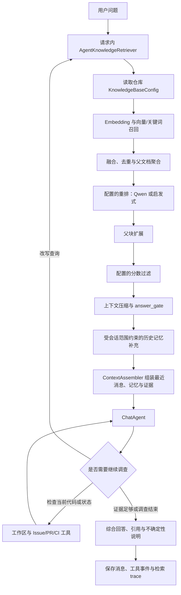

# ChatAgent 与 RAG 检索链路统一整改

整改日期：2026-10-20。

## 问题与结果

整改前，知识问答、RAG 搜索和召回测试调用 `retrieve_knowledge()`；聊天预检索、聊天检索工具和记忆搜索直接使用底层召回函数。因此，知识库页面中的配置没有完整影响聊天，完整的远程重排、父块扩展、阈值过滤和证据检查也没有贯通到聊天。

整改后，上述聊天入口复用现有 `retrieve_knowledge()`，读取同一份仓库配置。使用相同查询、来源范围、过滤条件及参数时，经过相同的核心处理阶段。入口仍可显式指定不同 Top-K 和过滤条件，因此不要求不同任务的返回列表完全相同。

此次验证证明的是配置与调用链贯通、过滤与作用域约束、降级和记录行为；没有据此宣称回答准确率已经提高。

## 整改后的链路

知识问答和召回测试继续直接使用同一核心检索函数。MCP 记忆搜索也经过统一 RAG，再补充允许范围内的历史记忆。评测通过隔离会话调用实际 ChatAgent，并记录送入 Agent 的证据和实际检索配置。

## 实现方式

### 1. 共用核心，区分使用策略

`rag/knowledge_base.py` 保留原有完整处理流程，增加 `qa` 与 `agent` 策略。默认仍是 `qa`，正式知识问答保留现有的证据不足、冲突、澄清处理。

Agent 策略同样执行配置的分数过滤。`answer_gate` 评价本次检索，并不直接结束整个 Agent：

| 检索状态 | Agent 收到的约束 |
| --- | --- |
| answer | 证据可供核对，结合其他来源形成结论 |
| insufficient_evidence | 可以改写查询、读代码或查询结构化状态 |
| conflict | 保留已过分数过滤的候选作为调查线索，核对来源和版本 |
| ask_clarification | 先结合对话定位对象，仍不明确时向用户澄清 |

候选分别标注为 `evidence`、`investigation_lead` 或 `historical_context`。最终综合判断通过 Agent 指令约束和工具状态传递实现，并未增加一个能形式化证明所有事实的验证器。

### 2. 增加薄适配层

`rag/agent_retrieval.py` 中的 `AgentKnowledgeRetriever` 负责调用共用流程、组织 Agent 检索结果、处理已知检索服务故障，以及在单次请求内复用相同的检索。

缓存键包含仓库、查询、Top-K、来源类型和元数据过滤条件。缓存不跨请求，返回深拷贝，防止消费者修改污染缓存。上下文余量检查和正式组装复用项目 RAG 结果；会话记忆每次重新读取，避免复用压缩前的旧记忆。

### 3. 防止过滤旁路

`EvidenceStore.search()` 原先会在 RAG 后再次从 `EvidenceItem` 按关键词补充仓库文档、Issue 等内容。现在只允许历史记忆、会话摘要和历史 Agent 记录走独立补充渠道。

已经被统一检索过滤掉的项目资料，不能通过旧补充渠道重新进入上下文。历史记忆保持仓库和会话范围限制，关键词命中次数单独记录，不再伪装成可与重排分数比较的相关性分数。

### 4. 串联异步与事务边界

聊天预检索、上下文组装和相关调用点改为 `await`，接入异步重排。Issue、PR、CI 中使用共享会话上下文的内部函数同步适配；它们原有的专用分析和代码检索策略保留。

Embedding 的模型计算或同步 HTTP 请求移入工作线程，数据库 Session 仍在原调用线程使用。这样 Embedding 等待时不必占住事件循环；这不意味着全部同步数据库或其他代码操作都已经异步化。

Agent 创建缺失的知识库配置时只 `flush`，不擅自 `commit`，提交和回滚仍由聊天请求或评测事务控制。评测的隔离会话及回滚行为有回归验证。

### 5. 贯通可观测记录

新增记录包括实际检索方式、Top-K、重排方式、降级原因、过滤数量、answer_gate、处理阶段、耗时与缓存命中。

- 预检索：`compression_stats.retrieval`、`context_diagnostics.pre_retrieval` 与 `rag_strategy` 事件。
- 主动检索：工具结果的 `retrieval_trace` 与 RecallEvent 元数据。
- MCP：保留原文本结果，额外传递 `structuredContent`，防止调用端丢失证据与 trace。
- 评测：即使一次检索返回空结果，也记录检索轨迹。

完整 trace 保存在事件和评测结果中，模型工具上下文只保留简短状态，避免诊断信息无谓挤占上下文预算。前端布局和操作流程未调整。

## 影响范围

主要修改：`rag/knowledge_base.py`、新增 `rag/agent_retrieval.py`、`chat_memory.py`、聊天路由、ChatAgent、MCP 记忆服务及 RAGAS 的上下文接入。

配套修改：手动记忆搜索；Issue/PR/CI 的共享会话上下文调用；相关异步测试。

HTTP 路由和请求模型保持兼容，原有工具名称保留，诊断信息通过已有字典字段扩展。没有数据库表结构迁移，没有改变 Embedding 向量空间，没有重新建立索引，没有迁移或重写历史消息。

## 验证

后端全量回归：225 项通过。新增 14 个参数展开后的测试案例覆盖：

- 聊天与正式问答使用相同配置和核心处理阶段。
- 配置的 Qwen 重排调用与父块扩展（远程重排使用测试替身）。
- 高阈值过滤后项目资料不能经记忆旁路重新进入。
- 会话记忆不跨仓库或指定会话泄漏。
- 正式问答保持严格策略，Agent 可在空检索后继续读工作区。
- 请求缓存隔离、结果变更隔离与不同查询重新检索。
- 缺失配置创建不提交调用方事务。
- 慢 Embedding 不阻塞事件循环。
- MCP 保留结构化检索信息。
- 流式与非流式聊天保存历史并复用预检索。
- 评测中被阈值过滤的证据真实体现为失败，隔离会话被回滚。

全量测试使用 SQLite、deterministic Embedding 和受控模型替身，不代表外部模型质量评测。

另使用当前本地 PostgreSQL、Milvus 和 Qwen Embedding 做真实配置检查：向量与关键词召回成功；同一查询的聊天与正式问答返回相同文档 ID；请求缓存命中；验证前后历史消息均为 16 条。

后端已重启加载整改。对运行服务的 HTTP 检查确认：RAG 搜索与手动记忆搜索中的项目 RAG 来源一致；首次加载 Embedding 时健康检查正常响应；16 条历史消息正常返回；重启前后的完整 OpenAPI JSON 一致，共 93 条路径。

当前未配置远程 Qwen 重排凭据，真实检查使用现有的启发式降级，并明确记录 `status=degraded` 和重排 fallback。本次没有更改凭据或降低现有分数阈值。实际远程重排效果及回答质量提升仍需在配置完整后重新跑固定评测。

## 后续验证

尚未进行固定数据集的整改前后质量对比，因此不应填写准确率提升、成本下降百分比等未经测量的数据。旧评测结果应结合旧检索路径解释，新链路需要重新建立基线。
