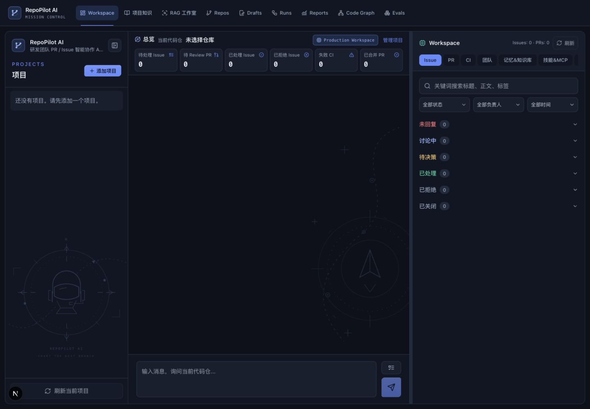

# RepoPilot AI · Mission Control 界面设计

界面基于 Next.js、React 和 Tailwind CSS，使用深色主题、轨道与导航元素表达研发协作和任务调查场景。

## 工作台布局

- 左侧项目栏管理仓库和会话，可折叠以释放横向空间。
- 中间为仓库总览与聊天区。总览支持一键收起和展开，保留统计、源码状态与资料扫描入口。
- 右侧 Workspace 展示 Issue、PR、CI、团队、知识、Skill / MCP 和图谱。桌面支持拖拽调整宽度，窄屏采用纵向布局。
- 工具过程、引用和上下文诊断按需展开，加载、失败和降级状态保持可见。



## 视觉规范

| 角色 | 色值 |
| --- | --- |
| 主背景 | #0D111B |
| 次背景 | #101623 |
| 卡片 | #171F2E |
| 悬浮表面 | #202B3D |
| 边框 | #293447 |
| 主文字 | #EDF2F9 |
| 次文字 | #9BAAC0 |
| 主操作 | #648BFF |
| 辅助色 | #46BFAE |
| 成功 | #3FBF94 |
| 警告 | #E5B567 |
| 错误 | #EA6C73 |

颜色集中在 `frontend/app/globals.css` 的 CSS Variables，通过 Tailwind 语义色映射使用；图谱节点和连线复用相同变量。图标使用 lucide-react，品牌图形由项目内 SVG 组件绘制。

常规界面使用系统无衬线字体，中文回退苹方、微软雅黑等字体；代码、日志和诊断数字使用等宽字形。控件保持一致的圆角、边框、焦点描边和加载反馈，表格优先在容器内横向滚动。

`PilotBackdrop` 中的头盔、罗盘、轨道和路径节点为静态装饰，使用低透明度细线，设置 `aria-hidden` 和 `pointer-events: none`，不参与业务布局或表达实时数据。动效响应 `prefers-reduced-motion`。

## 页面与组件

| 页面 | 展示重点 |
| --- | --- |
| `/` | 项目与会话、可折叠总览、聊天、任务详情、工具与检索 trace |
| `/repos` | 仓库连接、源码准备、同步与扫描状态 |
| `/issues`、`/pull-requests`、`/ci` | 专用分析结果、证据与执行过程 |
| `/knowledge`、`/knowledge/[id]` | 知识库、文档、切片、召回测试及检索配置 |
| `/rag` | 资料、问答与证据工作室 |
| `/action-drafts` | 待确认草稿、风险及执行状态 |
| `/workflow-runs` | 任务图、专用 Agent 结果与 Observer 发现 |
| `/code-graph` | 代码符号、关系、检索与快照 |
| `/evals` | 评测配置、进度、逐题诊断与回归对比 |
| `/reports`、`/workspaces` | 单仓库及团队工作区汇总 |

公共组件位于 `frontend/components/ui/`，导航布局位于 `frontend/components/layout/app-shell.tsx`。修改样式时，应同时检查桌面、窄屏、长文本、表格滚动和弹窗高度，避免用固定高度挤占聊天区域。

## 界面参考

以下图片用于说明界面布局，具体数据和运行状态以实际部署为准：

- [工作台导航](workspace-navigation.jpg)、[紧凑布局](workspace-compact.jpg)
- [仓库接入](repositories.jpg)、[移动端添加项目](add-project-mobile.jpg)
- [知识库设置](knowledge-settings.jpg)、[RAG 工作室](rag-studio.jpg)
- [工作流运行](workflow-runs.jpg)、[评测页面](evaluations.jpg)

## 验证入口

```sh
cd frontend
npm run build
npm run test:runtime
```

构建和运行保护检查覆盖编译、类型及开发实例互斥；真实对话、模型评测、仓库同步和外部写入需要单独执行相应的集成验证。
