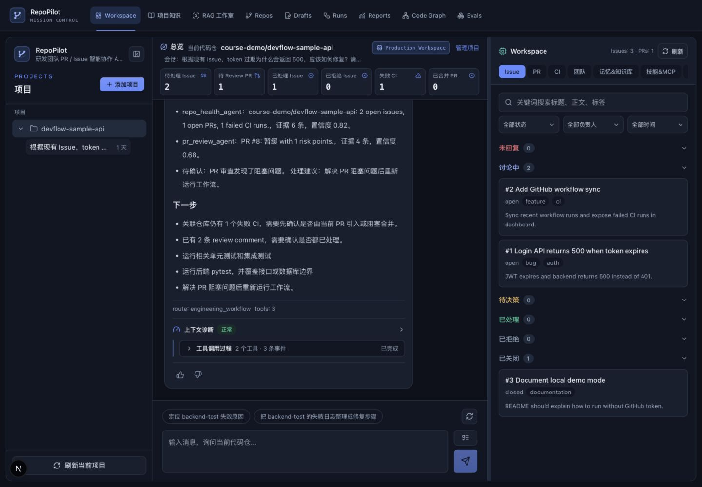
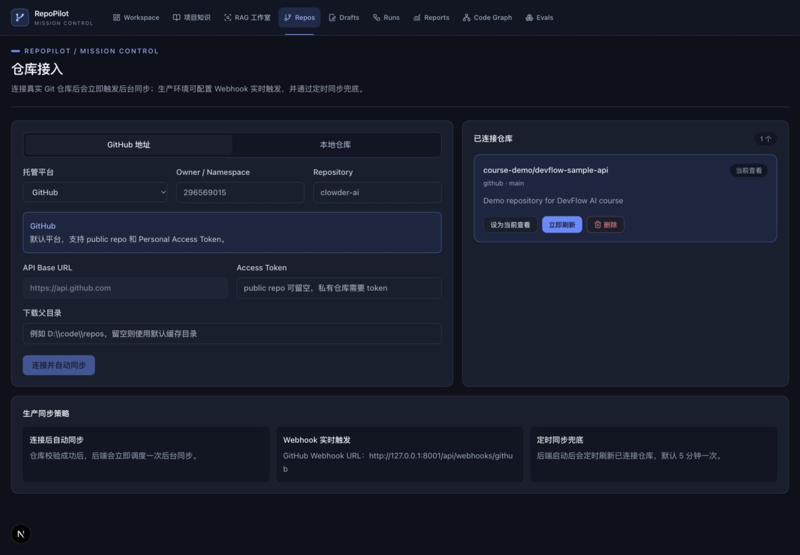
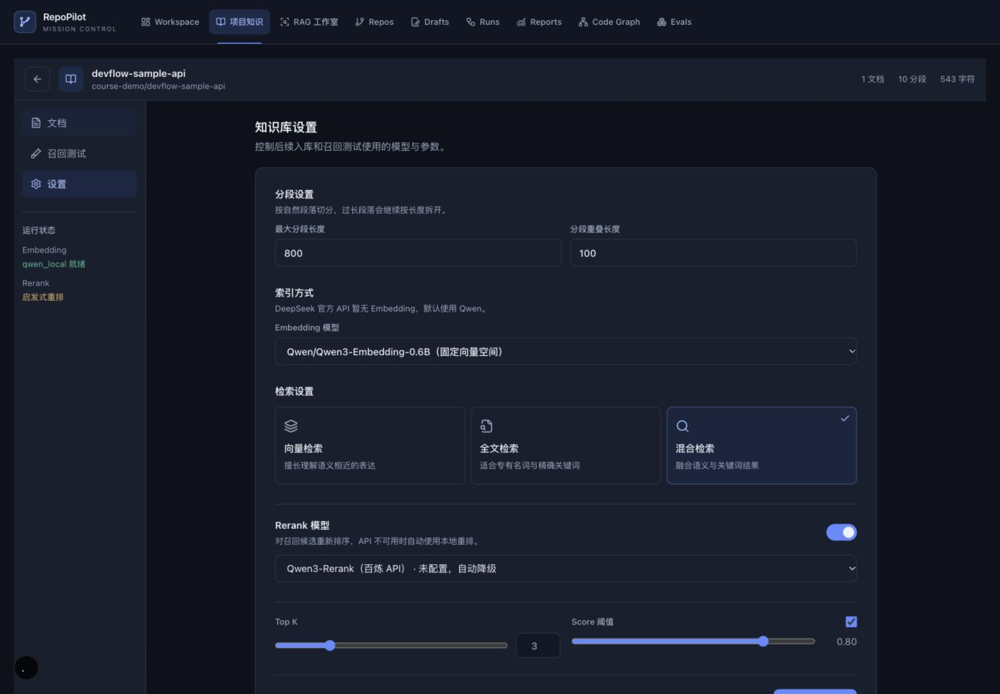
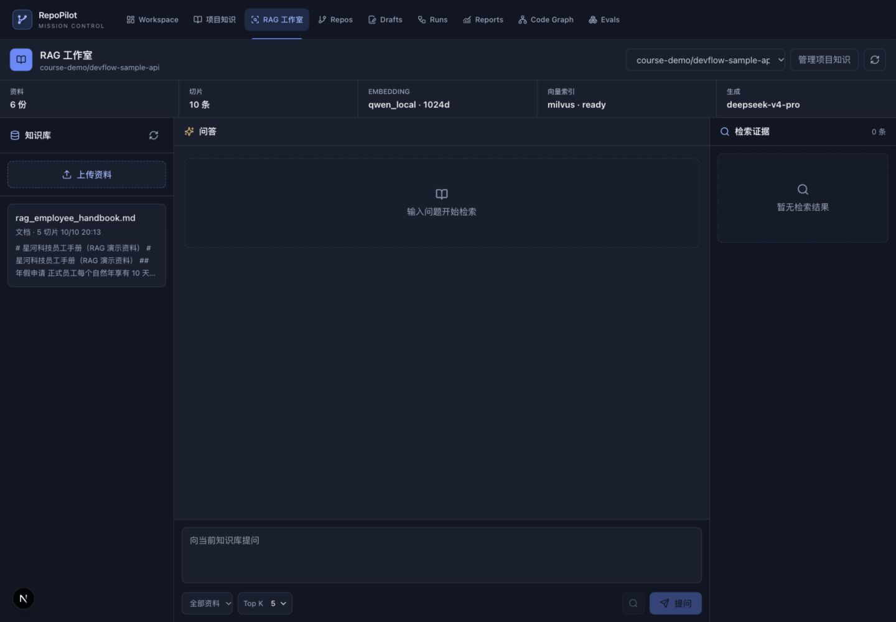
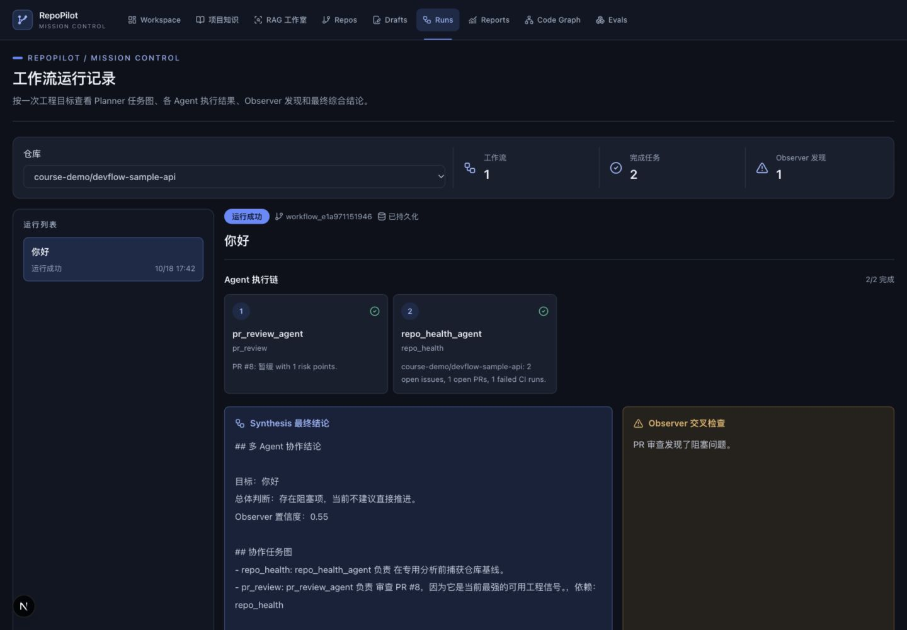
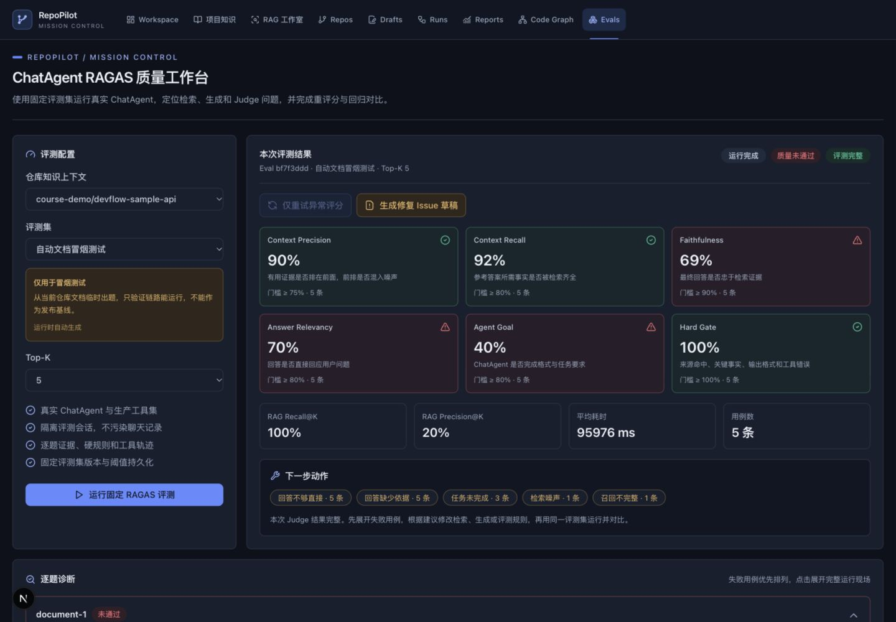
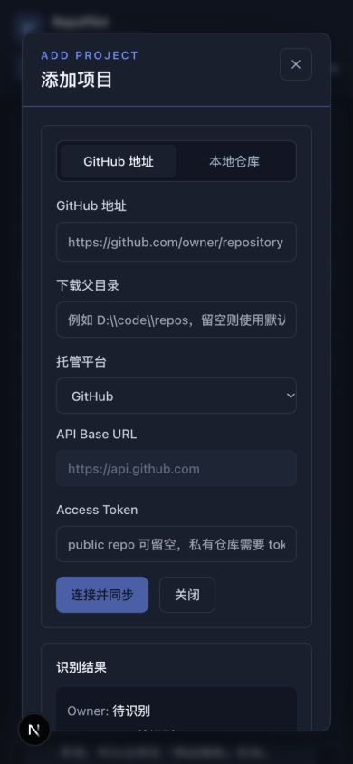

# RepoPilot AI · Mission Control 视觉升级

本次在原有 Next.js 15 / React 19 / Tailwind 3 项目上实施，覆盖全部 15 个页面。未更改后端、API 客户端、业务类型文件、路由、依赖清单和锁文件。页面历史记录、仓库描述及后端返回的旧品牌文字保持原始数据。

## 后续微调：紧凑总览与科技感细节

按照反馈，桌面总览恢复为一行六项指标，收紧标题与卡片内边距；会话名称保持单行，鼠标悬停可查看完整标题。1440px 宽度、同一数据状态下，总览从约 251px 降至约 128px，聊天消息区增加约 123px；827px 宽度下，总览从约 275px 降至约 177px。所有六项指标和原有操作入口均保留。

主要操作按钮增加轻微切角、细边缘高光与按压反馈；指标数字使用等宽字体，品牌副标题采用等宽字形。品牌标识增加轨道细线，总览和通用页面标题使用轨道图标，工作区使用芯片图标。没有新增运行状态或业务功能。

本轮修改范围：`frontend/app/page.tsx`、`frontend/app/globals.css`、`frontend/components/ui/card.tsx`、`frontend/components/ui/brand-mark.tsx`。

重新执行 TypeScript 检查、生产构建、Tailwind 样式编译和业务绑定 AST 对比，均通过。原有 13 条 Hooks 警告保留。检查了 1440px、827px、390px 宽度及共享按钮所在的仓库页面，未发现整页横向溢出。

## 领航员主题留白图案

新增纯装饰 SVG 组件 `frontend/components/ui/pilot-backdrop.tsx`：项目侧栏下方使用领航员头盔、罗盘刻度和分支航线；聊天区右侧使用导航箭头、轨道与路径节点；通用页面标题右侧使用小型领航罗盘。

图案采用主题蓝色、低透明度和静态细线，不代表真实任务数据，不新增动画、网络资源或依赖。所有装饰均设置 `aria-hidden` 和 `pointer-events: none`，绝对定位，不参与布局。侧栏折叠时移除头盔图案，手机端隐藏侧栏装饰并缩小其他图案。

本轮 TypeScript 检查、生产构建、业务绑定 AST 对比均通过，保留原有 Hooks 警告。浏览器验证了折叠/展开、鼠标点击穿透和 390px 页面宽度：没有整页横向溢出；1440px 下总览仍为约 128px。

## 视觉规范

采用深石墨色与冷蓝色；使用节点、路径、分支组成的轻量 SVG 品牌标识，复用现有 lucide-react 线性图标。

| 角色 | 色值 |
| --- | --- |
| 主背景 | #0D111B |
| 次背景 | #101623 |
| 卡片 | #171F2E |
| 悬浮表面 | #202B3D |
| 边框 | #293447 |
| 主文字 | #EDF2F9 |
| 次文字 | #9BAAC0 |
| 主操作 | #648BFF |
| 辅助色 | #46BFAE |
| 成功 | #3FBF94 |
| 警告 | #E5B567 |
| 错误 | #EA6C73 |

所有颜色集中在 `frontend/app/globals.css` 的 CSS Variables，通过 Tailwind 语义色映射使用；组件中原有的浅色、暖色硬编码已迁移到主题变量。图谱节点与连线也引用相同变量。

字体使用本机已有的 Inter / Geist / 系统字体，中文回退 Noto Sans SC、苹方和微软雅黑；代码与日志使用 JetBrains Mono / SFMono-Regular / Consolas 等宽字体栈。未下载字体，也未引入外部字体请求。

页面标题 24px，模块标题 14–16px，正文 13–14px，普通辅助文字 12px；保留原有紧凑诊断元信息的小字号。主要布局采用 Tailwind 的 4px / 8px 间距尺度，小图标和紧凑标签保留微间距。控件圆角 8px，面板圆角 12px，常规表单和按钮高 36–40px；图标按钮与紧凑操作保留较小尺寸。Focus 使用蓝色描边，主按钮采用深色前景以满足对比度。常规动效 150–160ms，响应 `prefers-reduced-motion`。

## 各类页面的调整

| 页面 | 视觉改进 |
| --- | --- |
| `/` 主工作台 | RepoPilot AI 标识、项目侧栏、总览指标、Agent 对话、Markdown、提示语、输入区、右侧任务面板统一主题；修正高度计算；桌面保留拖拽分栏，窄屏上下排布；拖拽显示宽度随可用空间限制；分析及添加项目弹层固定在视口内，防止长页面裁切。 |
| `/repos` | 仓库接入表单、来源切换、已连接仓库、当前选中状态与删除操作统一视觉。 |
| `/issues`、`/pull-requests`、`/ci` | 分析列表、操作按钮、选择器和结果日志统一配色，保留所有分析入口。 |
| `/chat` | 提问输入、建议按钮、加载反馈与原始流式结果的终端区域采用统一主题。 |
| `/knowledge` | 项目搜索、知识库卡片、模型状态、加载、错误和空状态统一样式。 |
| `/knowledge/[id]` | 文档列表、文档分段抽屉、召回测试、检索配置统一主题；修正手机端导航区域的不合理高度。 |
| `/rag` | 资料、问答、证据三栏统一背景层次；桌面保持三栏，窄屏改为纵向；手机摘要使用两列；保留上传、重建索引、来源选择、Top K 和检索入口。 |
| `/action-drafts` | 草稿操作、人工确认区和状态标签采用统一表面、边框及语义色。 |
| `/workflow-runs` | 运行列表、Agent 身份和职责、执行序号、状态、综合结论及 Observer 发现统一视觉；结论保留换行，便于阅读。 |
| `/code-graph` | 代码符号、关系、搜索、分支快照和代码输出统一主题；主工作台图谱的 SVG 颜色也同步适配。 |
| `/evals` | 配置、指标、诊断、回归对比、历史表格和进度采用统一视觉；表格保持局部横向滚动。 |
| `/reports`、`/workspaces` | 报表表单、团队工作区、统计、周报和结果输出统一组件规范。 |

全局导航保留原来的 9 个入口、文本、目标路径及顺序，仅增加图标、当前页面标识、键盘跳转主内容入口。未新增没有实际用途的主题切换。所有页面均使用深色主题；项目原先没有主题切换机制。

## 功能兼容性与验证

- `npm run build`：成功；所有业务路由均完成编译，动态知识库详情路由保留。
- `./node_modules/.bin/tsc --noEmit`：通过。
- 临时 TypeScript AST 对比：15 个页面和 2 个交互组件全部通过。检查了业务类型、API 调用表达式、Hooks、事件绑定，以及 value / checked / disabled / href / 表单约束 / 测试标识等属性；与改版前快照一致。图谱颜色辅助函数仅更换颜色常量。
- 浏览器页面检查：14 个静态业务路由及真实知识库动态详情均已访问；390px 和 1440px 下检查页面宽度，未发现整页横向溢出。工作台额外检查了 827px 与 1280px；表格内部滚动保持可用。
- 实际检查了项目侧栏折叠与展开、添加项目弹窗开关、远程/本地来源切换、PR 标签切换和详情、知识库文档/设置标签切换、文档分段抽屉。
- 使用已有数据检查了主工作台对话、Issue/PR 列表、工作流 Agent 输出、RAG 资料、知识库配置和评测历史的显示。没有添加演示业务数据。
- 手机添加项目弹窗实测位于 844px 视口内（top=36px、bottom=808px），表单内容可在弹窗内部滚动。
- 最终 RAG、评测页面检查期间未捕获新的浏览器 console error。开发期间出现过旧服务的 Tailwind 配置缓存编译错误，重新启动独立预览服务后已消除，最终构建通过。
- 关键文字/背景对比度计算：主文字 14.68:1，次文字 7.00:1，辅助文字 5.93:1，选中态文字 7.16:1，主按钮 5.83:1，成功 6.26:1，警告 7.75:1，错误 5.10:1。这里只核验指定的不透明颜色组合，不代表整站无障碍认证。
- `git diff --check`：通过。

## 未验证项目和已有提示

本次没有触发新的 Agent 推理任务、实时 SSE 对话、模型评测、仓库同步、上传/删除、GitHub 写入或其他持久化操作。因此这类端到端流程不能宣称已全部通过；它们的请求及事件代码保持不变。分析结果弹窗已统一样式，但未为截图而启动新分析任务。

生产构建保留 13 条 `react-hooks/exhaustive-deps` 警告，涉及原有的主工作台、仓库、RAG 和草稿页面；对应 Hooks 未修改。另有现有 Browserslist 数据较旧提示。没有为清除提示而修改业务依赖或 Hooks。

当前预览服务使用 `http://localhost:3001`；原有 3000 端口已有进程占用，未终止该进程。

## 修改文件

- `frontend/app/action-drafts/page.tsx`
- `frontend/app/chat/page.tsx`
- `frontend/app/ci/page.tsx`
- `frontend/app/code-graph/page.tsx`
- `frontend/app/evals/page.tsx`
- `frontend/app/globals.css`
- `frontend/app/issues/page.tsx`
- `frontend/app/knowledge/[id]/page.tsx`
- `frontend/app/knowledge/page.tsx`
- `frontend/app/layout.tsx`
- `frontend/app/page.tsx`
- `frontend/app/pull-requests/page.tsx`
- `frontend/app/rag/page.tsx`
- `frontend/app/reports/page.tsx`
- `frontend/app/repos/page.tsx`
- `frontend/app/workflow-runs/page.tsx`
- `frontend/app/workspaces/page.tsx`
- `frontend/components/feedback-controls.tsx`
- `frontend/components/layout/app-shell.tsx`
- `frontend/components/rag/retrieval-settings.tsx`
- `frontend/components/ui/card.tsx`
- `frontend/tailwind.config.ts`
- `frontend/components/ui/brand-mark.tsx`
- `frontend/components/ui/pilot-backdrop.tsx`

新增本目录交付说明与页面截图：工作台、仓库、知识库设置、RAG、工作流、评测、手机添加项目弹窗，以及后续紧凑总览和领航员主题图案的截图。

## 视觉记录

### 主工作台

### 仓库接入

### 知识库设置

### RAG 工作室

### 工作流运行

### 评测工作台

### 手机添加项目

